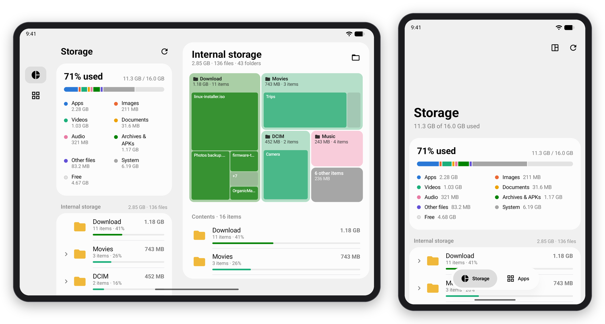
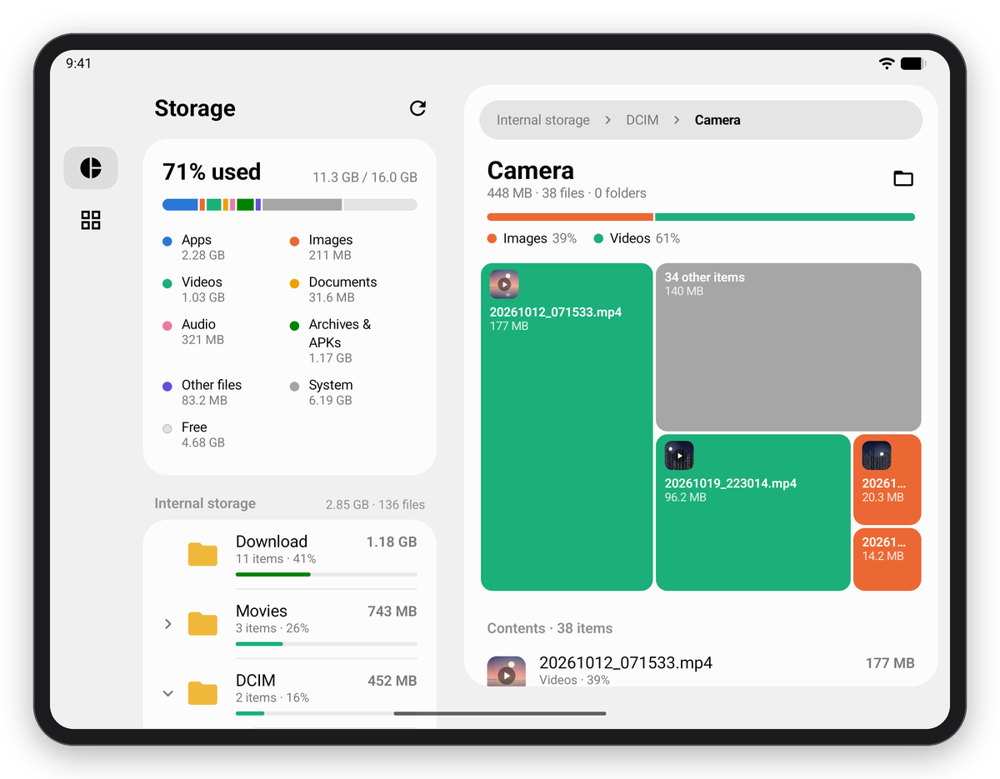
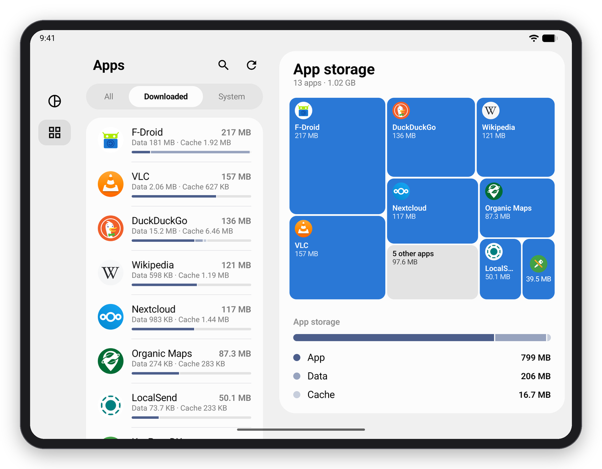
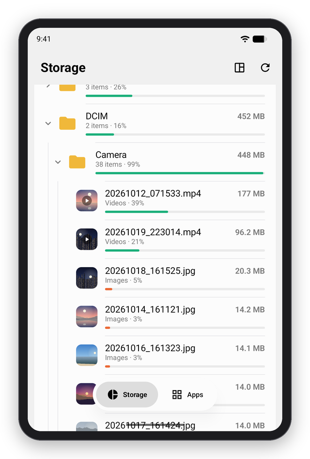
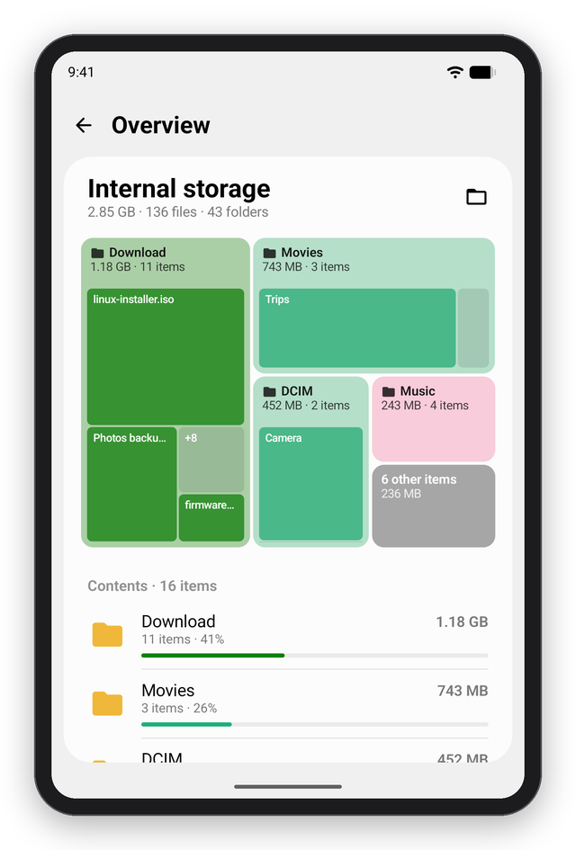
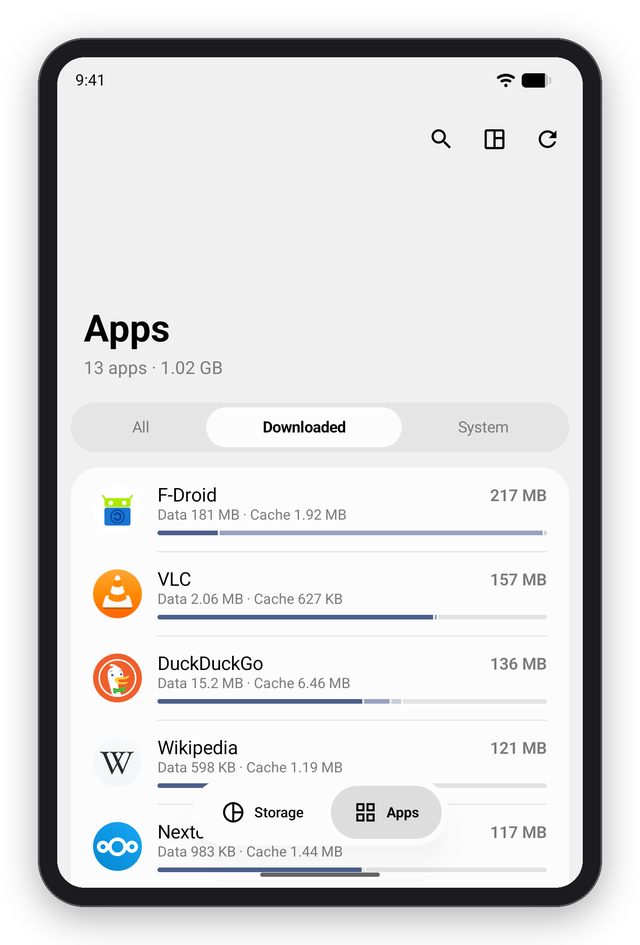
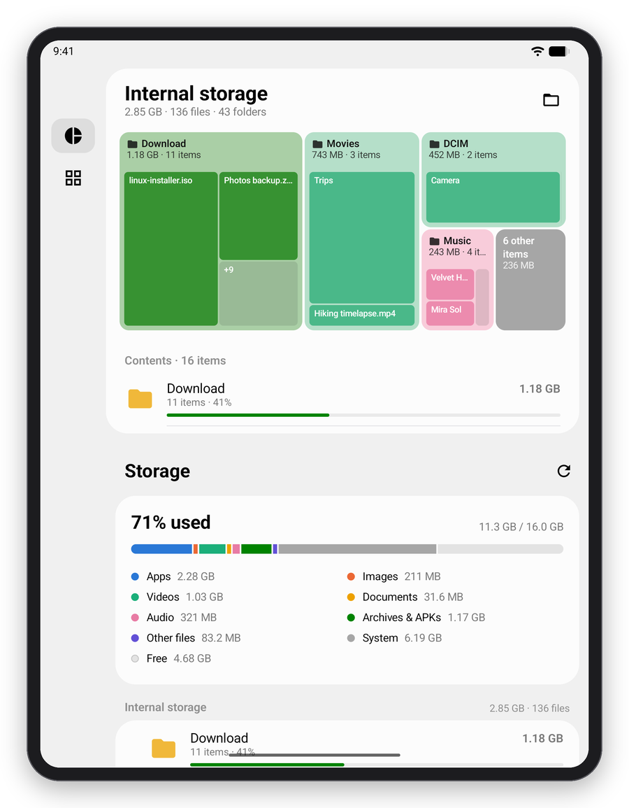
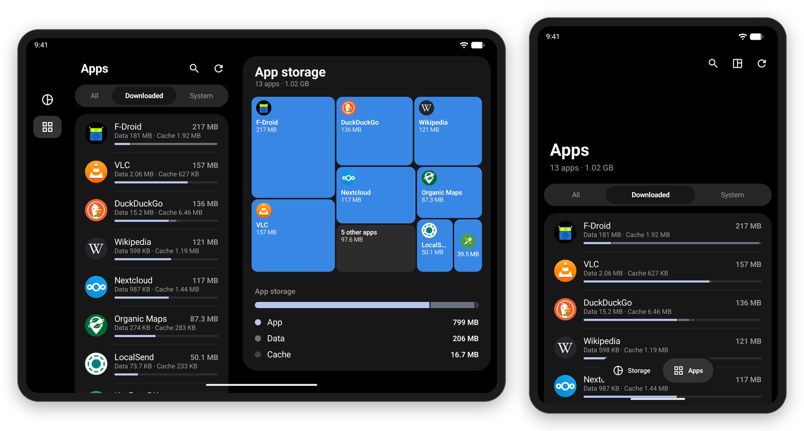

<div align="center">


# StorageViewer

**See what's filling up your phone, with no risk of deleting anything.**

StorageViewer is a read-only storage and app-size inspector for Android. It's styled after Samsung One UI 9 and built for foldables like the Galaxy Z Fold8.

[](https://github.com/JustBuddy/storageviewer/releases/latest)


<br>

<picture>
  <source media="(prefers-color-scheme: dark)" srcset="assets/screenshots/hero-dark.png">
  
</picture>

</div>

## ✨ Features

- **Storage at a glance.** One bar shows what is using the device: apps, images, videos, documents, audio, archives, system files and free space.
- **A folder tree sorted by size.** The biggest folders are always on top and each one has a share bar, so you can follow the space down to the files that use it.
- **Treemaps.** Any folder can be shown as tiles sized by bytes and coloured by file type. Tap a folder tile to go into it, or tap a file to open it.
- **Thumbnails.** Files show a preview where they have one: photos, video frames, album art, the first page of a PDF and the icon inside an APK.
- **Apps by size.** Every installed app, largest first, with its app, data and cache sizes. You can filter by downloaded, all or system apps, and search.
- **Made for foldables.** The cover screen gets one pane and a large One UI title. Unfolded, the tree and the overview sit on either side of the hinge. In tabletop mode the overview moves above the fold. Folding or unfolding keeps your place.
- **Light and dark.** The app follows the system theme and takes its accent colour from your colour palette.
- **Strictly read-only.** StorageViewer never changes anything on your phone ([more below](#-read-only-by-design)).
- **English and German.**

## 📸 Screenshots

### Unfolded

| Open any folder | Apps, largest first |
|:---:|:---:|
|  |  |

### Folded (cover screen)

| Browse the tree | Overview | Apps |
|:---:|:---:|:---:|
|  |  |  |

### Tabletop and dark mode

| Half-folded: overview above the fold | Dark mode |
|:---:|:---:|
|  |  |

<sub>The screenshots were taken on the Android emulator, set up like a Galaxy Z Fold8 and filled with sample files.</sub>

## 📥 Install

1. Download `StorageViewer-<version>.apk` from the [latest release](https://github.com/JustBuddy/storageviewer/releases/latest).
2. Open it on your phone. If Android asks, allow your browser or file manager to install apps.
3. Start StorageViewer and grant the two special accesses it asks for. Each button opens the right Settings page.

You need Android 12 or newer. StorageViewer is built and tested on a Galaxy Z Fold8 with One UI 9, but it runs on any Android phone or tablet, and the layout adapts to the screen.

## 🔒 Read-only by design

StorageViewer never writes, moves or deletes anything. Every tap is passed to the app that normally handles it:

| Tap | Goes to |
|---|---|
| Folder | Opens it in the tree. On the inner screen it also shows on the right. Long-press offers *Open in My Files*. |
| File | Its default viewer, with read-only access |
| App | Android's App info page |

Under the hood, the scan only calls `readdir` and `lstat`. Thumbnails open files read-only and are kept in memory only. Nothing is cached on disk, including MediaStore's thumbnail cache. The `FileProvider` that hands files to viewers refuses anything except read access.

Android has no read-only version of "All files access", so the app holds the standard permission. No code path uses it to write.

## 🔑 Permissions

| Permission | What it's for |
|---|---|
| All files access (`MANAGE_EXTERNAL_STORAGE`) | Measuring folder sizes in shared storage |
| Usage access (`PACKAGE_USAGE_STATS`) | Reading each app's data and cache size |
| `QUERY_ALL_PACKAGES` | Listing every installed app |

Both special accesses are requested in the app and granted in Settings. Without usage access, apps show their install size only. No app can read `Android/data` or `Android/obb`, so their contents are counted in each app's size instead.

## 🛠️ Build from source

You'll need the Android SDK (API 37) and JDK 17 or newer. Android Studio's bundled JBR works.

```sh
./gradlew assembleRelease        # app/build/outputs/apk/release/app-release.apk
./gradlew testDebugUnitTest      # unit tests
./gradlew lintDebug
adb install -r app/build/outputs/apk/release/app-release.apk
```

> [!TIP]
> Use the release build on a real phone. Debug builds run Compose unoptimised and stutter at 120 Hz. The release build is shrunk with R8 and ships baseline profiles. To get full speed right away instead of after Android's background optimisation, run:
> `adb shell cmd package compile -m speed-profile -f wtf.buddyworks.storageviewer`

<details>
<summary><b>Signing and publishing releases</b> (for maintainers)</summary>

### Signing

Release builds are signed with the key named in `keystore.properties` next to `settings.gradle.kts`. That file is gitignored.

```properties
storeFile=C:/Users/you/.android/storageviewer-release.jks
storePassword=…
keyAlias=storageviewer
keyPassword=…
```

CI reads the same values from `SIGNING_*` environment variables. If neither is set, release builds fall back to the debug key. Android won't install a debug-signed copy over a release-signed one, or the other way round. Keep a backup of the keystore, because updates only install over a copy signed with the same key.

### Releases

The version lives in `gradle.properties` (`storageviewer.version`), and the version code is derived from it. To publish a release:

1. Bump `storageviewer.version` and merge.
2. Tag the merge commit `v<version>` and push the tag, for example `git tag v0.2.0 && git push origin v0.2.0`.

The [Release APK](.github/workflows/release.yml) workflow runs the unit tests, builds the signed APK and attaches `StorageViewer-<version>.apk` to a GitHub release for the tag. It fails if the tag and `storageviewer.version` don't match. Pull requests run the same build and keep the APK as a run artifact.

The workflow needs these repository secrets: `SIGNING_KEYSTORE_BASE64` (the keystore, base64-encoded), `SIGNING_STORE_PASSWORD`, `SIGNING_KEY_ALIAS` and `SIGNING_KEY_PASSWORD`.

</details>

## 🧱 Built with

- [Kotlin](https://kotlinlang.org/) and [Jetpack Compose](https://developer.android.com/compose), with a custom One UI theme on top of Material 3
- [AndroidX Window](https://developer.android.com/jetpack/androidx/releases/window) for the hinge and posture
- R8 and baseline profiles for smooth 120 Hz scrolling

---

<div align="center">
<sub>Created in <a href="https://t3.codes">T3 Code</a>.</sub>
</div>
